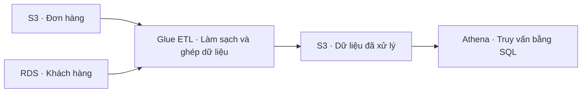
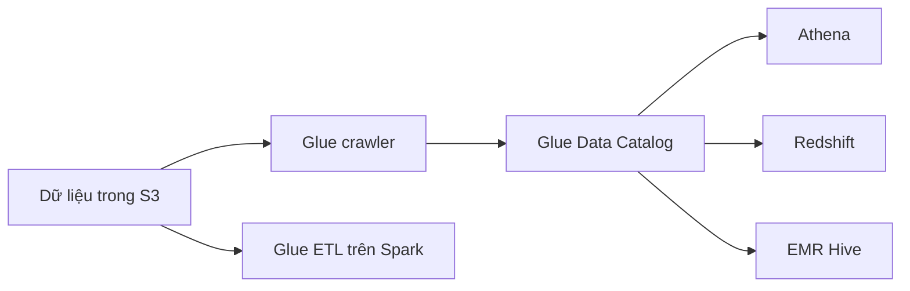

**AWS Glue** là dịch vụ tích hợp dữ liệu của AWS. Bạn dùng Glue để **đọc dữ liệu từ nhiều nguồn, làm sạch hoặc kết hợp dữ liệu, rồi ghi kết quả** [[ETL (Extract - Transform - Load)]] vào nơi như Amazon S3 hay Redshift. AWS quản lý hạ tầng chạy các tác vụ này.

Ví dụ, mỗi đêm Glue đọc **đơn hàng từ S3** và **thông tin khách hàng từ RDS**, ghép chúng theo `customer_id`, rồi ghi kết quả thành file Parquet trên S3 để Athena truy vấn.

Ba thành phần bạn thường gặp:

- **Glue ETL Job** chạy logic xử lý dữ liệu. Job có thể chạy theo lô (_batch_) hoặc đọc luồng liên tục (_streaming_).
- **[[Glue Data Catalog]]** lưu thông tin mô tả bảng như tên cột, kiểu dữ liệu và vị trí file. Trong ví dụ trên, dữ liệu thực tế vẫn nằm trên S3.
- **[[GLUE Crawler]]** khảo sát nguồn dữ liệu để tự tạo hoặc cập nhật thông tin bảng trong Catalog.

![[Pasted image 20261103153910.png]]