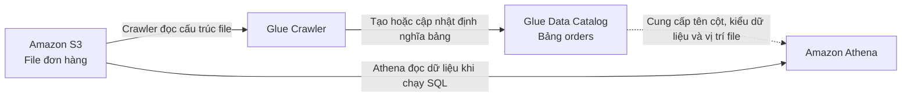

**[[GLUE Crawler]] khảo sát dữ liệu, <mark style="background:#b1ffff">còn Glue Data Catalog lưu thông tin mà Crawler tìm được.</mark>** Ví dụ, nếu bạn có các file Parquet chứa đơn hàng trên S3, hai thành phần này phối hợp để Athena có thể truy vấn các file đó như một bảng SQL.

1. Bạn cấu hình **Crawler** trỏ vào thư mục `s3://my-bucket/orders/`.
2. Crawler nhận diện các cột như `order_id`, `customer_id`, `total_amount` và đăng ký bảng `orders` trong **Data Catalog**.
3. Khi bạn chạy `SELECT SUM(total_amount) FROM orders`, **Athena** tra Catalog để biết cấu trúc bảng và vị trí file, rồi đọc dữ liệu trực tiếp từ **S3**.

Bước Crawler → Catalog chỉ ghi **metadata**. Các file đơn hàng vẫn nằm ở S3.