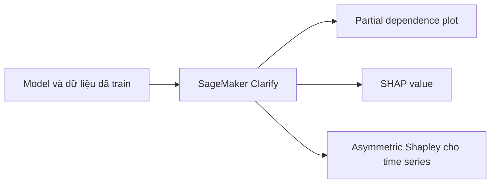

**Amazon SageMaker Clarify** là công cụ giúp bạn **phát hiện dấu hiệu thiên lệch (_bias_) và giải thích dự đoán của mô hình ML**. Bạn có thể dùng Clarify ở ba bước. [Tài liệu AWS về SageMaker Clarify](https://docs.aws.amazon.com/sagemaker/latest/dg/clarify-configure-processing-jobs.html)

> [!warning]
> **Data Wrangler có biểu đồ để bạn khám phá dữ liệu. Clarify tính các chỉ số cụ thể để đo thiên lệch và giải thích dự đoán của mô hình.** Hai tính năng có phần giao nhau vì bạn có thể dùng kiểm tra thiên lệch của Clarify ngay trong Data Wrangler.

|Bước|Clarify giúp trả lời câu hỏi gì?|
|---|---|
|**Trước khi huấn luyện**|Các nhóm có được đại diện đủ trong dữ liệu không? Tỷ lệ nhãn có chênh lệch giữa các nhóm không?|
|**Sau khi huấn luyện**|Mô hình có đưa ra kết quả hoặc mắc lỗi với tỷ lệ khác nhau giữa các nhóm không?|
|**Khi giải thích dự đoán**|Đặc trưng nào đóng góp nhiều nhất vào một dự đoán cụ thể?|

Ví dụ, với mô hình xét duyệt khoản vay, Clarify có thể đo **chênh lệch tỷ lệ được duyệt giữa các nhóm**. Với một hồ sơ cụ thể, nó có thể ước tính các đặc trưng như **thu nhập** hoặc **tỷ lệ nợ trên thu nhập** đã đẩy điểm dự đoán lên hay xuống. Những kết quả này giúp bạn xác định chỗ cần xem xét thêm. [Tài liệu AWS về thiên lệch và giải thích dự đoán](https://docs.aws.amazon.com/sagemaker/latest/dg/clarify-configure-processing-jobs.html)

Trong quy trình bạn đang học, **Data Wrangler chuẩn bị dữ liệu và tạo đặc trưng**, còn **Clarify đánh giá thiên lệch trong dữ liệu hoặc kết quả mô hình và giải thích dự đoán**. [AWS Data Wrangler](https://docs.aws.amazon.com/sagemaker/latest/dg/canvas-data-prep.html) · [AWS Clarify](https://docs.aws.amazon.com/sagemaker/latest/dg/clarify-configure-processing-jobs.html)

AWS hiện đã **ngừng mở Clarify cho khách hàng mới**. Khách hàng hiện tại vẫn có thể tiếp tục sử dụng. [Thông báo trong tài liệu AWS](https://docs.aws.amazon.com/sagemaker/latest/dg/clarify-configure-processing-jobs.html)

### sự khác nhau giữa [[SageMaker Data Wrangler]] và sagemaker clarify 

| Bạn muốn biết gì?                                                                            | Dùng gì?                                                      |
| -------------------------------------------------------------------------------------------- | ------------------------------------------------------------- |
| Thu nhập phân bố thế nào? Có bao nhiêu hồ sơ thiếu dữ liệu?                                  | **Biểu đồ và thống kê của Data Wrangler**                     |
| Trong dữ liệu lịch sử, tỷ lệ được duyệt của nhóm A và nhóm B chênh nhau bao nhiêu?           | **Clarify trước huấn luyện**, có thể dùng trong Data Wrangler |
| Sau khi huấn luyện, mô hình có dự đoán “được duyệt” với tỷ lệ khác nhau giữa hai nhóm không? | **Clarify sau huấn luyện**                                    |
| Với một hồ sơ cụ thể, thu nhập và tỷ lệ nợ đã ảnh hưởng thế nào đến điểm dự đoán?            | **Tính năng giải thích dự đoán của Clarify**                  |