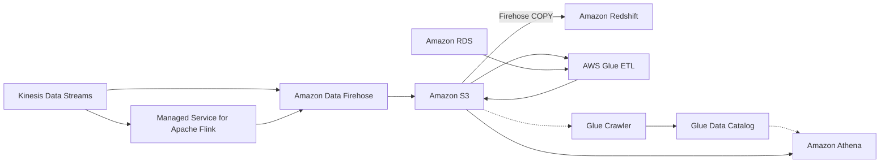
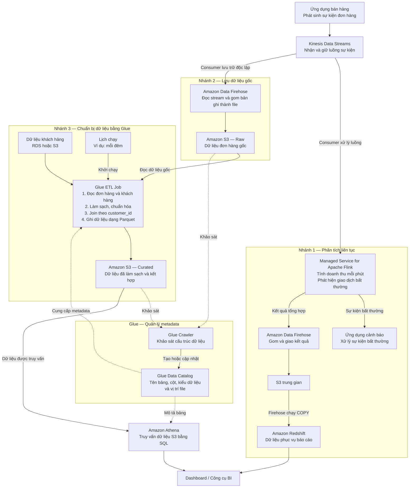

1. [[Kinesis Data Streams]]: lấy dữ liệu trực tiếp từ nguồn (không thực hiện biến đổi hoặc tính toán) - hiện tại đang được thay thế bằng [[Amazon MSK (Managed streaming for apache kafka)]]
2. [[Data Firehouse]]: lấy dữ liệu từ **data stream** hoặc những produce khác để thực hiện biến đổi (chỉ biến đổi thôi)
3. [[AWS Glue]]: thực hiện sử lý dữ liệu, làm sạch, tinh chỉnh và chuẩn bị dữ liệu 
4. [[Amazon Flink (Amazon Managed Service for Apache Flink)]]: là nơi tính toán dữ liệu realtime để chuyển sang destination

> [!note]
> Trong pipeline bạn đang học, **Kinesis Data Streams hoặc MSK giữ luồng sự kiện**, **Firehose gom và chuyển dữ liệu đến đích**, còn **Glue ETL chuẩn bị dữ liệu để phân tích**. Glue có thể đọc trực tiếp từ Kinesis hoặc MSK khi bạn muốn xử lý luồng thay vì chờ file trên S3.

## Chi tiết

