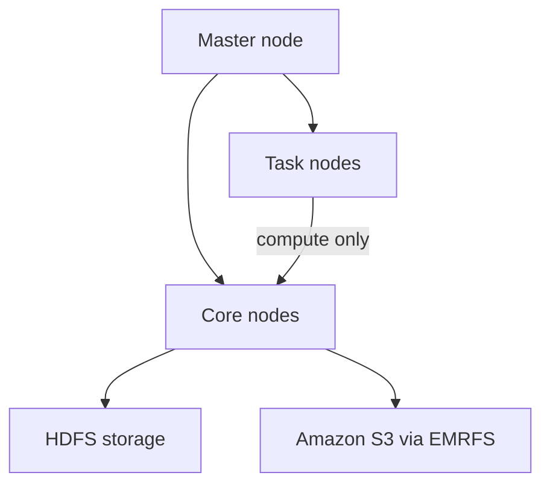

**HDFS (Hadoop Distributed File System)** là **hệ thống lưu trữ tệp phân tán của Hadoop**. <mark style="background:#b1ffff">Nó cho phép chia một tệp lớn thành nhiều phần và lưu chúng trên nhiều máy tính, nhưng người dùng vẫn truy cập như một tệp hoàn chỉnh.</mark>

Hãy tưởng tượng bạn có **tệp dữ liệu 1 TB**, quá lớn để xử lý thuận tiện trên một máy. HDFS chia tệp thành các **khối dữ liệu (block)** rồi phân bố chúng lên nhiều máy trong một cụm.
![[Pasted image 20261028135820.png|533]]
HDFS có hai thành phần chính:

có thể sử dụng [[Amazon EMR (Elastic MapReduce)]] để đóng vai các "Core node" và giả lập lại toàn bộ [[HDFS]] cũng như bạn có thể sử dụng [[S3 standard]] như một [[HDFS]] hoàn chỉnh 

|Thành phần|Vai trò|Ví dụ dễ hiểu|
|---|---|---|
|**NameNode**|Quản lý thông tin về tệp: gồm những block nào, nằm trên máy nào|Người quản lý danh mục sách|
|**DataNode**|Lưu các block dữ liệu thực tế và phục vụ việc đọc, ghi|Các kho chứa sách|
> [!warning]
> mỗi block dữ liệu trong [[HDFS]] có dung lượng default là 128mb

Khi bạn đọc một tệp:

1. Máy của bạn hỏi **NameNode** vị trí các block.
2. NameNode trả về danh sách **DataNode** đang giữ chúng.
3. Máy của bạn đọc dữ liệu **trực tiếp từ các DataNode**.

**Dữ liệu không đi qua NameNode**; NameNode chủ yếu chỉ đường.

### Nếu một máy bị hỏng thì sao?

HDFS thường lưu **nhiều bản sao của mỗi block**, chẳng hạn 3 bản trên các máy khác nhau. Nếu một máy hỏng, hệ thống có thể đọc bản sao từ máy còn hoạt động và tạo thêm bản sao để khôi phục mức dự phòng.

### Vì sao HDFS phù hợp với Big Data?

- **Lưu dữ liệu lớn:** tăng dung lượng bằng cách bổ sung máy.
- **Chịu lỗi:** một máy hỏng không nhất thiết làm mất dữ liệu.
- **Đọc dữ liệu với thông lượng cao:** phù hợp với việc quét và xử lý những tập dữ liệu lớn.
- **Hỗ trợ xử lý gần nơi lưu dữ liệu:** các công cụ như Spark có thể bố trí công việc gần máy chứa dữ liệu, giúp giảm lượng truyền qua mạng.

Đổi lại, HDFS **không phù hợp với rất nhiều tệp nhỏ, truy vấn cần phản hồi cực nhanh hoặc sửa ngẫu nhiên từng phần của tệp**. Nó được thiết kế chủ yếu cho tệp lớn, ghi tuần tự và đọc nhiều lần.

Trong một quy trình ML, **HDFS có thể lưu dữ liệu huấn luyện; Spark xử lý dữ liệu đó; thuật toán ML học từ dữ liệu đã xử lý**. HDFS đảm nhiệm phần lưu trữ, bản thân nó không huấn luyện mô hình.